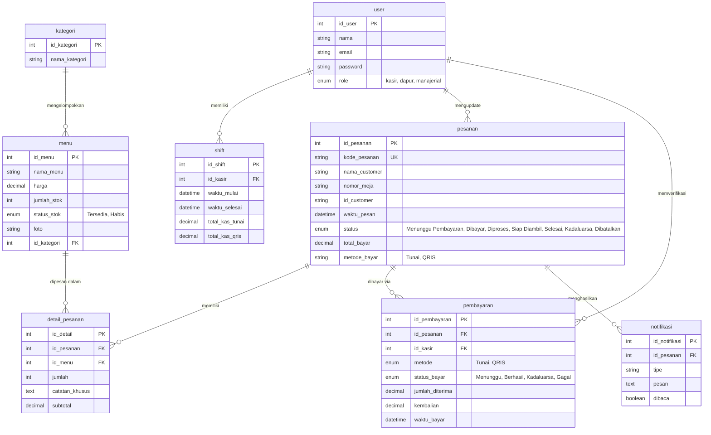

# 📚 PANDUAN STRUKTUR SISTEM & PETA ROLE: KANTIN MERAH POS
> **Dokumen Resmi Arsitektur untuk Pengembang & AI Assistant**  
> *Sistem Point of Sale (POS) Self-Service & Kitchen Display System Kantin Merah UNP Kampus 1 Kediri*  
> *Framework: CodeIgniter 4 (PHP 8.x) | Database: MySQL (`kantin_merah_db`)*

Dokumen ini disusun sebagai **panduan utama bagi AI atau pengembang baru** agar dapat langsung memahami pemetaan berkas (*file mapping*), alur kerja (*workflow*), serta fitur-fitur dari 4 role utama: **Customer**, **Kasir**, **Dapur**, dan **Manajer**.

---

## 🧭 Ringkasan Cepat: "Jika Ingin Merevisi X, Buka Berkas Mana?"

| Kebutuhan Revisi | Berkas Controller | Berkas View (Tampilan) | Berkas Model |
|---|---|---|---|
| **Katalog Menu & Keranjang Customer** | `app/Controllers/CustomerController.php` | `app/Views/customer/index.php` `app/Views/customer/cart.php` `app/Views/customer/menu_detail.php` | `MenuModel.php` `KategoriModel.php` |
| **Checkout, Nama Pemesan & Meja** | `app/Controllers/CustomerOrderController.php` | `app/Views/customer/checkout.php` `app/Views/customer/status.php` | `PesananModel.php` `DetailPesananModel.php` `PembayaranModel.php` |
| **Antrean Kasir & Pembayaran Tunai** | `app/Controllers/KasirController.php` `app/Controllers/PembayaranController.php` | `app/Views/kasir/index.php` | `PesananModel.php` `PembayaranModel.php` |
| **Buka / Tutup Shift Kasir** | `app/Controllers/ShiftController.php` | `app/Views/kasir/shift.php` `app/Views/kasir/index.php` | `ShiftModel.php` |
| **Kitchen Display / Antrean Dapur (FIFO)** | `app/Controllers/DapurController.php` | `app/Views/dapur/index.php` | `PesananModel.php` `DetailPesananModel.php` |
| **Ketersediaan Menu Habis / Tersedia** | `app/Controllers/DapurController.php` `app/Controllers/MenuController.php` | `app/Views/dapur/index.php` `app/Views/manajerial/menu.php` | `MenuModel.php` |
| **Laporan Omset & Grafik Penjualan** | `app/Controllers/ManajerialController.php` | `app/Views/manajerial/index.php` | Query DB Builder (`pesanan`, `pembayaran`) |
| **CRUD Menu & Kategori Produk** | `app/Controllers/MenuController.php` `app/Controllers/KategoriController.php` | `app/Views/manajerial/menu.php` | `MenuModel.php` `KategoriModel.php` |
| **Login, Logout, & Akun Staf** | `app/Controllers/AuthController.php` | `app/Views/auth/login.php` | `UserModel.php` |
| **Routing & Filter Hak Akses** | `app/Config/Routes.php` | - | `app/Config/Filters.php` |

---

## 1. 🛒 ROLE: CUSTOMER (PEMESANAN MANDIRI / SELF-SERVICE)

### 📌 Karakteristik & Hak Akses
- **Akses**: Publik (*Tanpa Login*). Pelanggan memesan mandiri via ponsel/browser meja.
- **URL Utama**: `http://localhost:8080/customer`

### 🎯 Fitur-Fitur Customer
1. **Katalog & Kategori Menu**:
   - Menampilkan daftar makanan, minuman, dan camilan dengan foto, harga, dan ketersediaan stok (*Tersedia* / *Habis*).
   - Filter menu instan berdasarkan kategori tab (Semua, Makanan Berat, Minuman Segar, Snack).
2. **Detail Menu & Catatan Khusus**:
   - Modal popup rincian porsi menu dan input catatan khusus pelanggan (misal: *"tidak pedas"*, *"es sedikit"*).
3. **Keranjang Belanja (*Cart*)**:
   - Tersimpan di `localStorage` peramban pelanggan (`kantin_merah_cart`), mendukung tambah/kurang jumlah dan hapus item.
4. **Checkout dengan Identitas Pemesan & Nomor Meja**:
   - Input **Nama Pemesan** (misal: *Budi / Rivaldo*) dan pilihan cepat **Nomor Meja** (*Meja 01 s/d Meja 08* serta *Bungkus*).
   - Pilihan metode bayar: **Tunai (di kasir)** atau **QRIS**.
5. **Pelacakan Status Pesanan Real-Time**:
   - Pelanggan dapat memantau pergerakan status pesanan: `Menunggu Pembayaran` $\rightarrow$ `Dibayar` $\rightarrow$ `Diproses (Dimasak)` $\rightarrow$ `Siap Diambil`.
6. **Papan TV Pesanan Siap Diambil**:
   - Daftar pesanan yang sudah selesai dimasak oleh dapur, menampilkan kode pesanan, nama pemesan, dan nomor meja pengantaran.

### 📂 Berkas Terkait Role Customer
- **Controller**:
  - `app/Controllers/CustomerController.php`:
    - `index()`: Merender halaman katalog atau merespon JSON menu jika dipanggil via AJAX.
    - `menuByKategori($id)`: Filter menu per kategori.
    - `detailMenu($id)`: Mengambil detail satu menu.
    - `pesananSiap()`: Endpoint publik daftar pesanan berstatus `Siap Diambil`.
  - `app/Controllers/CustomerOrderController.php`:
    - `checkout()`: Menerima payload JSON keranjang belanja, nama pemesan, nomor meja, dan metode bayar; membuat record di tabel `pesanan`, `detail_pesanan`, dan `pembayaran`.
    - `status($kodePesanan)`: Mengembalikan data detail dan status pesanan pelanggan.
- **Views**:
  - `app/Views/customer/index.php`: Halaman katalog utama dan script perender antrean siap saji.
  - `app/Views/customer/menu_detail.php`: Modal rincian menu.
  - `app/Views/customer/cart.php`: Modal keranjang belanja.
  - `app/Views/customer/checkout.php`: Modal formulir identitas nama, nomor meja, dan pemilihan metode pembayaran.
  - `app/Views/customer/status.php`: Modal pelacakan status pesanan secara berkala.
- **Routes (`app/Config/Routes.php`)**:
  - `GET /customer` $\rightarrow$ `CustomerController::index`
  - `GET /customer/menu/(:num)` $\rightarrow$ `CustomerController::detailMenu/$1`
  - `GET /customer/kategori/(:num)` $\rightarrow$ `CustomerController::menuByKategori/$1`
  - `GET /customer/pesanan-siap` $\rightarrow$ `CustomerController::pesananSiap`
  - `POST /customer/checkout` $\rightarrow$ `CustomerOrderController::checkout`
  - `GET /customer/pesanan/(:segment)` $\rightarrow$ `CustomerOrderController::status/$1`

---

## 2. 💵 ROLE: KASIR (TRANSAKSI, SHIFT & PENGANTARAN)

### 📌 Karakteristik & Hak Akses
- **Akses**: Memerlukan Login dengan role `kasir`. Dilindungi middleware `filter => ['auth', 'role:kasir']`.
- **URL Utama**: `http://localhost:8080/kasir`
- **Kredensial Demo**: `kasir@kantinmerah.com` | Password: `password`

### 🎯 Fitur-Fitur Kasir
1. **Manajemen Shift Kasir (Buka / Tutup Shift)**:
   - Kasir wajib memiliki shift aktif sebelum memproses pembayaran uang tunai.
   - Menghitung akumulasi kas tunai dan non-tunai (QRIS) yang masuk selama shift berlangsung.
   - Riwayat penutupan shift dan rekapitulasi setoran kas.
2. **Antrean Pembayaran Tunai & QRIS**:
   - Menampilkan pesanan pelanggan yang berstatus `Menunggu Pembayaran`.
   - Dilengkapi identitas jelas: **🪑 Lokasi / ID Meja** dan **👤 Nama Pemesan**.
3. **Kalkulator Kembalian Otomatis**:
   - Kasir mengetik nominal uang yang diterima pelanggan, sistem otomatis menghitung uang kembalian secara real-time.
4. **Konfirmasi Pembayaran**:
   - Menekan tombol *Konfirmasi Bayar* akan mengubah status pesanan dari `Menunggu Pembayaran` menjadi `Dibayar`, yang otomatis meneruskan tiket pesanan ke antrean Dapur.
5. **Pembatalan Pesanan**:
   - Kasir dapat membatalkan pesanan yang belum dibayar jika pelanggan membatalkan pesanan.
6. **Penyerahan Pesanan ke Meja Pelanggan (*Selesai*)**:
   - Daftar pesanan yang berstatus `Siap Diambil` (sudah selesai dimasak dapur).
   - Menampilkan banner instruksi: **"Kirim / Antar ke Meja XX (a.n Nama Pemesan)"**.
   - Tombol **"Kirim / Antar ke Meja (Selesai)"** mengubah status akhir menjadi `Selesai`.

### 📂 Berkas Terkait Role Kasir
- **Controller**:
  - `app/Controllers/KasirController.php`:
    - `index()`: Mengambil shift aktif, daftar pesanan menunggu bayar, dan pesanan siap diantar.
    - `selesai($idPesanan)`: Endpoint kasir untuk menandai pesanan selesai diserahkan ke pembeli.
    - `riwayat()`: Menampilkan riwayat transaksi kasir.
  - `app/Controllers/PembayaranController.php`:
    - `store($idPesanan)`: Memproses pembayaran kasir (metode tunai/QRIS, jumlah uang, kembalian, update status pembayaran $\rightarrow$ `Berhasil`, status pesanan $\rightarrow$ `Dibayar`).
  - `app/Controllers/ShiftController.php`:
    - `buka()`: Membuka shift kasir baru.
    - `tutup()`: Menutup shift berjalan dan mencatat total uang kas masuk.
    - `index()`: Halaman kelola dan riwayat shift kasir.
- **Views**:
  - `app/Views/kasir/index.php`: Dashboard utama kasir (banner shift aktif, antrean verifikasi pembayaran tunai, kalkulator kembalian, dan daftar penyerahan pesanan siap saji).
  - `app/Views/kasir/shift.php`: Halaman kelola shift kasir dan riwayat pembukuan kas.
- **Routes (`app/Config/Routes.php`)**:
  - `GET /kasir` $\rightarrow$ `KasirController::index`
  - `POST /kasir/pesanan/(:num)/selesai` $\rightarrow$ `KasirController::selesai/$1`
  - `GET /kasir/shift` $\rightarrow$ `ShiftController::index`
  - `POST /shift/buka` $\rightarrow$ `ShiftController::buka`
  - `POST /shift/tutup` $\rightarrow$ `ShiftController::tutup`
  - `POST /pesanan/(:num)/pembayaran` $\rightarrow$ `PembayaranController::store/$1`

---

## 3. 🍳 ROLE: DAPUR / CHEF (KITCHEN DISPLAY SYSTEM - KDS)

### 📌 Karakteristik & Hak Akses
- **Akses**: Memerlukan Login dengan role `dapur`. Dilindungi middleware `filter => ['auth', 'role:dapur']`.
- **URL Utama**: `http://localhost:8080/dapur`
- **Kredensial Demo**: `dapur@kantinmerah.com` | Password: `password`

### 🎯 Fitur-Fitur Dapur
1. **Tampilan Kitchen Display System (KDS)**:
   - Antarmuka khusus bertema gelap (*dark mode*) yang nyaman untuk layar dapur dengan **Auto-Refresh otomatis berkala (setiap 15 detik)**.
2. **Antrean Masak Berprinsip FIFO (*First-In, First-Out*)**:
   - **Kolom 1: Pesanan Masuk (`Dibayar`)**: Tiket pesanan yang telah dikonfirmasi pembayarannya oleh kasir. Pesanan yang masuk lebih dahulu berada di urutan teratas. Tombol **"🍳 Mulai Masak"** mengubah status menjadi `Diproses`.
   - **Kolom 2: Sedang Dimasak (`Diproses`)**: Menampilkan item makanan yang sedang aktif dibuat oleh koki. Tombol **"🔔 Selesai Masak (Siap Diambil)"** mengubah status menjadi `Siap Diambil`.
3. **Informasi Tiket Pesanan Lengkap**:
   - Menampilkan kode pesanan, waktu masuk, jumlah kuantitas, catatan khusus pelanggan (misal: *Pedas sedang, tanpa seledri*), serta **Nomor Meja dan Nama Pemesan**.
4. **Saklar Ketersediaan Menu (*Toggle Stock Out*)**:
   - Panel di sisi kanan KDS yang memungkinkan staf dapur langsung mengubah status menu antara **Tersedia** dan **Habis** tanpa harus masuk ke panel manajer. Menu yang ditandai *Habis* otomatis tidak dapat dipesan oleh pelanggan.

### 📂 Berkas Terkait Role Dapur
- **Controller**:
  - `app/Controllers/DapurController.php`:
    - `index()`: Merender antarmuka KDS dapur (atau JSON jika dipanggil via polling AJAX).
    - `proses($idPesanan)`: Mengubah status pesanan dari `Dibayar` $\rightarrow$ `Diproses`.
    - `siapDiambil($idPesanan)`: Mengubah status pesanan dari `Diproses` $\rightarrow$ `Siap Diambil`.
    - `toggleMenuHabis($idMenu)`: Mengubah status ketersediaan menu (`Tersedia` $\leftrightarrow$ `Habis`).
- **Views**:
  - `app/Views/dapur/index.php`: Halaman antarmuka KDS dua kolom antrean FIFO dan sidebar saklar ketersediaan menu.
- **Routes (`app/Config/Routes.php`)**:
  - `GET /dapur` $\rightarrow$ `DapurController::index`
  - `POST /dapur/pesanan/(:num)/proses` $\rightarrow$ `DapurController::proses/$1`
  - `POST /dapur/pesanan/(:num)/siap-diambil` $\rightarrow$ `DapurController::siapDiambil/$1`
  - `POST /dapur/menu/(:num)/toggle` $\rightarrow$ `DapurController::toggleMenuHabis/$1`

---

## 4. 📊 ROLE: MANAJERIAL / OWNER (LAPORAN & KELOLA MENU)

### 📌 Karakteristik & Hak Akses
- **Akses**: Memerlukan Login dengan role `manajerial`. Dilindungi middleware `filter => ['auth', 'role:manajerial']`.
- **URL Utama**: `http://localhost:8080/manajerial`
- **Kredensial Demo**: `manajerial@kantinmerah.com` | Password: `password`

### 🎯 Fitur-Fitur Manajerial
1. **Laporan Kinerja & Rekapitulasi Penjualan Eksekutif**:
   - Tampilan formal standar laporan audit keuangan institusi kampus.
2. **Kartu Metrik KPI Bisnis**:
   - Total Omset Bruto Penjualan.
   - Total Transaksi Sukses & Rata-rata Nilai Order (*Average Order Value*).
   - Akumulasi Penerimaan Tunai (*Cash*) beserta persentase porsi.
   - Akumulasi Penerimaan QRIS (*Non-Tunai*) beserta persentase porsi.
3. **Analisis Menu Terlaris (*Top Selling*) & Jam Sibuk (*Peak Hours*)**:
   - Peringkat menu terfavorit (*Gold, Silver, Bronze*) berdasarkan kuantitas porsi terjual dan omset yang disumbangkan.
   - Distribusi kepadatan order berdasarkan jam operasional kantin.
4. **Navigasi Tanggal Periode ("Previous", "Next", & "Go")**:
   - Tombol **`◀ Previous`** dan **`Next ▶`** untuk melangkah mundur atau maju hari/minggu/bulan.
   - Input tanggal langsung **Dari: [date] s/d [date]** + tombol **`➔ Go`** untuk menerapkan rentang tanggal spesifik.
   - Tab cepat: *Hari Ini, 7 Hari, Bulan Ini, 30 Hari*.
5. **Tabel Riwayat Rincian Transaksi Penjualan**:
   - Paginasi default **5 baris per halaman** (dengan opsi: 5, 10, 25, 50, Semua).
   - Tombol paginasi **`◀ Previous`**, nomor halaman, dan **`Next ▶`**.
   - Fitur **Go to Page**: input nomor halaman `Ke Hal: [ input ]` + tombol **`➔ Go`**.
   - Pencarian real-time (Kode Pesanan, Nama Pemesan, Nomor Meja).
   - Filter Status Pesanan dan Metode Pembayaran.
   - Baris Total Rekapitulasi (*TFOOT*) otomatis menghitung grand total tagihan, diterima, dan kembalian.
6. **Ekspor & Cetak Laporan Resmi**:
   - **Cetak / Print Laporan**: Tampilan cetak resmi (`@media print`) lengkap dengan kop universitas dan kolom tanda tangan pengesahan kasir & manajer.
   - **Unduh CSV**: Ekspor data transaksi ke spreadsheet `.csv`.
7. **Kelola Menu & Kategori Produk**:
   - CRUD Produk: Tambah menu baru, edit nama, harga, stok, upload foto produk, dan ganti kategori.
   - CRUD Kategori: Tambah dan kelola kategori produk makanan/minuman.

### 📂 Berkas Terkait Role Manajerial
- **Controller**:
  - `app/Controllers/ManajerialController.php`:
    - `index()`: Merender tampilan view laporan eksekutif.
    - `laporan()`: Endpoint API kalkulasi data omset, metode bayar, menu terlaris, jam sibuk, dan daftar transaksi berfilter tanggal.
  - `app/Controllers/MenuController.php`:
    - `index()`: Merender halaman kelola menu (`manajerial/menu`).
    - `store()`, `update()`, `delete()`: Operasi simpan, perbarui, dan hapus menu.
  - `app/Controllers/KategoriController.php`:
    - Operasi CRUD kategori produk makanan dan minuman.
- **Views**:
  - `app/Views/manajerial/index.php`: Halaman laporan penjualan resmi lengkap (KPI, analisis, tabel 5 baris + Previous/Next/Go, print stylesheet).
  - `app/Views/manajerial/menu.php`: Halaman kelola produk menu makanan/minuman dan kategori.
- **Routes (`app/Config/Routes.php`)**:
  - `GET /manajerial` $\rightarrow$ `ManajerialController::index`
  - `GET /manajerial/laporan` $\rightarrow$ `ManajerialController::laporan`
  - `GET /menu` $\rightarrow$ `MenuController::index`
  - `POST /menu` $\rightarrow$ `MenuController::store`
  - `POST /menu/(:num)` $\rightarrow$ `MenuController::update/$1`
  - `DELETE /menu/(:num)` $\rightarrow$ `MenuController::delete/$1`
  - `GET /kategori` $\rightarrow$ `KategoriController::index`

---

## 5. 🔐 AUTENTIKASI, FILTER, & NAVIGASI SISTEM

### 📂 Berkas-Berkas Inti
- `app/Controllers/AuthController.php`:
  - `login()`: Merender form login.
  - `attemptLogin()`: Memvalidasi kredensial email dan password hash via `password_verify()`. Mendukung fallback provisioning untuk akun demo.
  - `logout()`: Menghapus session staf dan me-redirect ke login.
- `app/Views/auth/login.php`:
  - Desain modern bernuansa merah UNP.
  - **Fitur 1-Click Login**: Tombol instan login sebagai Kasir, Dapur, atau Manajer untuk kemudahan demonstrasi pengujian.
- `app/Controllers/Home.php`:
  - Router cerdas: Jika diakses tamu/publik diarahkan ke `/customer`, jika sudah login diarahkan ke dashboard role masing-masing.
- `app/Filters/AuthFilter.php` & `app/Filters/RoleFilter.php`:
  - Mencegah akses silang antar role (misal: kasir tidak boleh membuka halaman dapur/manajerial).

---

## 🗄️ 6. STRUKTUR DATABASE (`kantin_merah_db`)

Database terdiri dari 8 tabel relasional yang saling terhubung:

---

## ⚠️ 7. ATURAN & CATATAN KRITIS BAGI PENGEMBANG / AI LAINNYA

1. **Aturan Model CodeIgniter 4 (`$updatedField`)**:
   - Tabel `detail_pesanan`, `kategori`, dan `pembayaran` **tidak memiliki kolom `updated_at`**.
   - Jika membuat atau mengedit Model CI4 dengan `$useTimestamps = true;`, **WAJIB** mendefinisikan `protected $updatedField = '';`. Jika diabaikan, CI4 akan melempar fatal error: `Unknown column 'updated_at' in 'field list'`.
2. **Auto-Migration Kolom `pesanan`**:
   - Model `app/Models/PesananModel.php` memiliki method `ensureColumns()` di dalam `initialize()`. Method ini menjamin kolom `nama_customer`, `nomor_meja`, `id_customer`, dan `metode_bayar` selalu otomatis terbuat di MySQL jika tabel `pesanan` belum memilikinya.
3. **Penyimpanan Nilai Uang (Currency)**:
   - Seluruh nilai rupiah menggunakan tipe data `DECIMAL(10,2)` di MySQL dan diformat dengan pemisah ribuan titik pada tampilan peramban (`number_format` di PHP atau `Intl.NumberFormat('id-ID')` di JavaScript).
4. **Alur Status Pesanan**:
   - Jangan pernah mengubah status pesanan secara acak di luar urutan daur hidup:
     `Menunggu Pembayaran` $\rightarrow$ `Dibayar` $\rightarrow$ `Diproses` $\rightarrow$ `Siap Diambil` $\rightarrow$ `Selesai`.
5. **Port & URL Server**:
   - Server lokal standar berjalan di: `http://localhost:8080/`
   - File konfigurasi base URL ada di `app/Config/App.php` (`baseURL = 'http://localhost:8080/'`) dan berkas `.env` (`app.baseURL = 'http://localhost:8080/'`).
